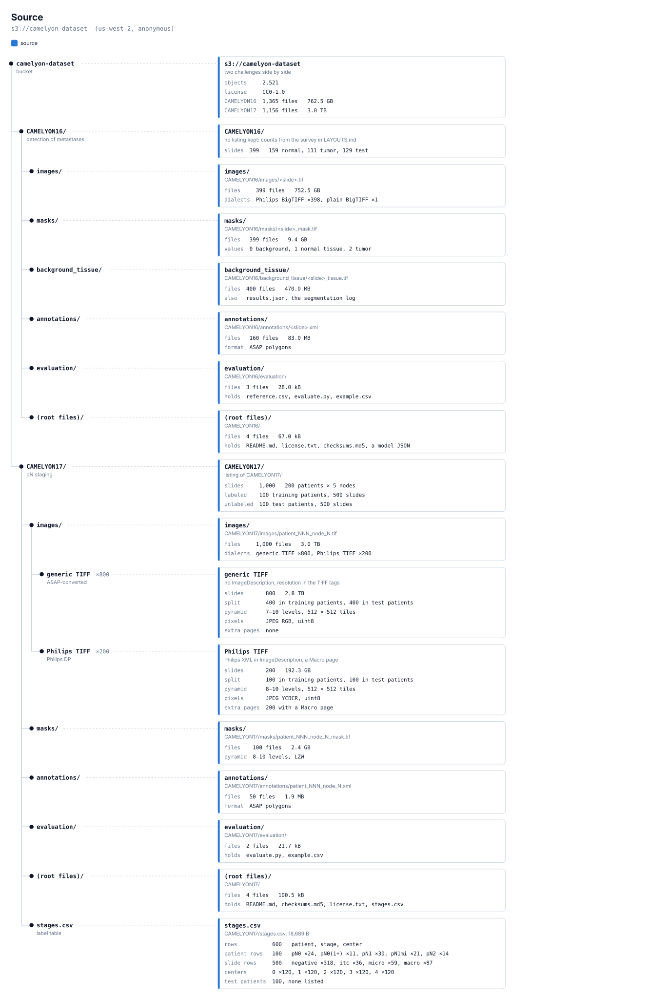
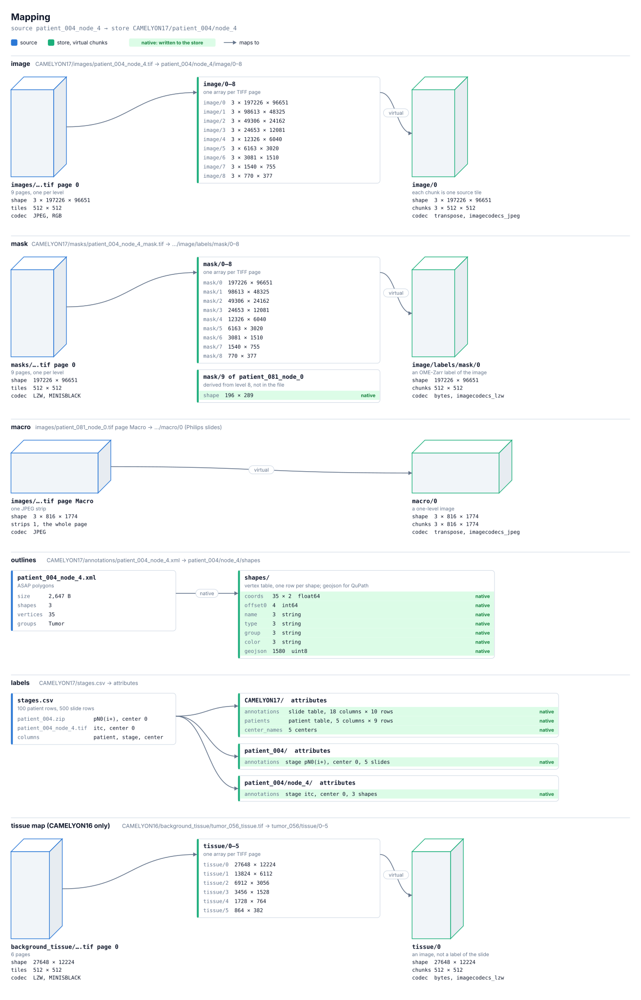
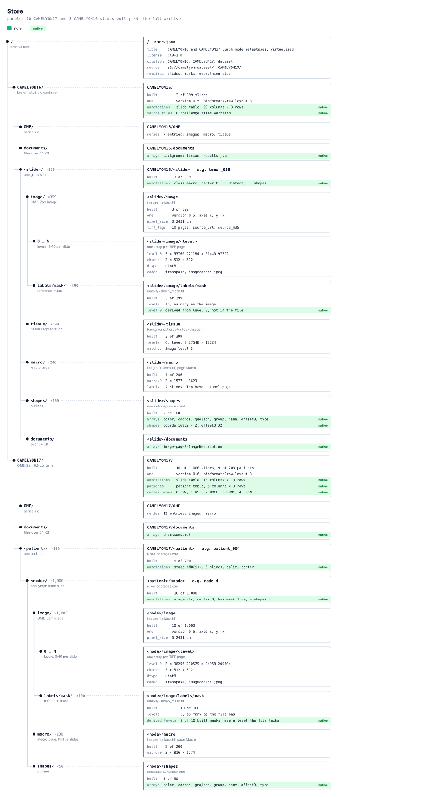

# CAMELYON layout

How the files in `s3://camelyon-dataset` map onto one Icechunk store, and why.
The store holds both challenges: CAMELYON16 as published in
`earthmover-biology/camelyon`, and CAMELYON17 as `ingest.py` writes it.
`PLAN.md` holds the decisions still open; this page records the mapping and
the judgement calls behind it.



## The source

`s3://camelyon-dataset` (us-west-2, anonymous, CC0) holds the two challenges
side by side. The CAMELYON16 counts are from a full bucket listing on
2026-09-24; the CAMELYON17 counts are from a listing of `CAMELYON17/` on
2026-11-19.

| Prefix | Objects | Size | What |
| --- | ---: | ---: | --- |
| `CAMELYON16/images/` | 399 `.tif` | 752.5 GB | whole-slide images: `normal_NNN` 159, `tumor_NNN` 111, `test_NNN` 129 |
| `CAMELYON16/masks/` | 399 `.tif` | 9.41 GB | `<slide>_mask.tif`, one per slide: 0 background, 1 normal tissue, 2 tumor |
| `CAMELYON16/background_tissue/` | 399 `.tif` + `results.json` | 0.47 GB | `<slide>_tissue.tif`, automatic tissue segmentation, and its run log |
| `CAMELYON16/annotations/` | 160 `.xml` | 83 MB | ASAP polygons: all 111 `tumor_*`, and the 49 tumor-bearing `test_*` |
| `CAMELYON16/evaluation/` | 3 | 28 KB | `reference.csv` (399 rows: type, class, center), `evaluate.py`, `example.csv` |
| `CAMELYON16/` root | 4 | 67 KB | `README.md`, `license.txt` (CC0 1.0), `checksums.md5`, `pathology-tissue-background-segmentation.json` |
| `CAMELYON17/images/` | 1,000 `.tif` | 2,973.8 GB | `patient_NNN_node_N.tif`, 200 patients with 5 lymph nodes each |
| `CAMELYON17/masks/` | 100 `.tif` | 2.39 GB | the 50 annotated slides, and 50 negative slides, 10 per center |
| `CAMELYON17/annotations/` | 50 `.xml` | 1.9 MB | ASAP polygons, same schema as CAMELYON16, 10 slides per center |
| `CAMELYON17/evaluation/` | 2 | 22 KB | `evaluate.py`, and `example.csv`, a sample submission for the test patients |
| `CAMELYON17/` root | 4 | 100 KB | `README.md`, `license.txt` (CC0), `checksums.md5`, `stages.csv` |

### Joins

Every file joins to its slide by exact basename: `images/X.tif`,
`masks/X_mask.tif`, `background_tissue/X_tissue.tif` (CAMELYON16),
`annotations/X.xml`, the row of the label table, and the line of
`checksums.md5`.

- **CAMELYON16.** All 399 slides have a mask and a tissue file; no
  annotation lacks a slide. `normal_086` and `test_049` are missing from the
  numbering, both explained by the README. `checksums.md5` covers every file
  except itself, `background_tissue/` and the segmentation settings, which
  were added later.
- **CAMELYON17.** Every annotated slide has a mask. The other 50 masks
  belong to slides `stages.csv` labels `negative`. `checksums.md5` lists the
  50 annotated slides' masks and none of the 50 negative slides' masks.
  `stages.csv` has 600 rows: one `patient_NNN.zip` row per training patient
  (000 to 099) with its pN stage and center, and one row per slide with its
  label (negative 318, itc 36, micro 59, macro 87). The bucket gives no label
  and no center for the test patients, 100 to 199. `evaluation/example.csv`
  lists them with made-up stages, as a submission format; it is not a label
  table.

### TIFF dialects

The CAMELYON16 slides come in three dialects, from a header census of all
1,197 CAMELYON16 TIFFs:

| Files | Dialect | Pyramid | Extra pages |
| --- | --- | --- | --- |
| 244 slides | Philips-format BigTIFF, scanner 3D Histech (`center` 0) | 8 to 10 levels, 512² tiles, YCbCr JPEG with `JPEGTables` | one "Macro" strip |
| 154 slides | Philips-format BigTIFF, scanner Hamamatsu (`center` 1) | same | none, except `normal_114` and `normal_145`: "Macro" and "Label" |
| 1 slide (`normal_144`) | generic BigTIFF, RGB JPEG with `JPEGTables`, no ImageDescription | 9 levels | none |
| 399 masks, 399 tissue files | generic BigTIFF, LZW, 512² tiles, uint8 | masks 8 to 10 levels, tissue 5 to 7 | none |

The CAMELYON17 slides come in two, from a census of all 1,100 CAMELYON17
TIFF headers on 2026-11-19 (no pixels decoded). Two slides per center were
read in full, with the same result:

| Center | Slides | Dialect | Pixel size (level 0) | Levels | Extra pages |
| --- | ---: | --- | --- | --- | --- |
| 0 | 100 | generic BigTIFF, RGB JPEG, `JPEGTables`, no ImageDescription | resolution tags: 0.243094 µm | 9 | none |
| 1 | 100 | same | 0.243094 µm | 9 | none |
| 2 | 100 | same | resolution tags: 0.2263 to 0.2269 µm | 8 to 10 | none |
| 3 | 100 | same | 0.243094 µm | 9 | none |
| 4 | 100 | Philips-format BigTIFF, YCbCr JPEG, `JPEGTables`, `Software` "Philips DP v1.0" | ImageDescription only: 0.25 µm, scanned and representation alike | 9 or 10 | one "Macro" strip |
| test | 400 generic, 100 Philips | as above | as above | 8 to 10 | Macro on the Philips slides |
| masks | 100 | generic BigTIFF, LZW, 512² tiles, uint8 | resolution tags | 7 to 10 | none |

All 1,000 slides use 512 × 512 tiles of 8-bit, 3-sample JPEG with shared
`JPEGTables`. The generic files are CAMELYON16's `normal_144` dialect and
the Philips files are CAMELYON16's majority dialect, so one code path
handles every slide: `level_array` writes the same `imagecodecs_jpeg` chain
with the color spaces tifffile's own decoder would pick
(`colorspace_jpeg: "RGB"` for the generic files, which have no JFIF marker).
A Philips ImageDescription is about 11 KB in CAMELYON17, against 1 MB in
CAMELYON16, so none needs the documents rule below.

**Cropped Philips levels.** In 44 of CAMELYON17's 200 Philips slides, some
reduced levels stop up to a tile short of level 0's shape halved: 21 in
width, 27 in length. `patient_081_node_0` level 3 is 18,432 wide where
147,968 / 8 is 18,496, and `patient_080_node_2` level 3 is 9,728 rows long
where 78,336 / 8 is 9,792. tifffile keeps the shorter width but reads the
length as the halved value, past the page's last row of tiles;
`level_array` keeps the page's own tags (`docs/upstream.md`). Comparing that level with level 2 averaged down puts every tested
region at a shift of 0, where rescaling would predict 32 to 60 pixels, so
the scanner cropped the level and kept its 2× pixel size. The masks of these
slides keep the full halved width at those levels.

**Masks align with slides.** Every mask level k has the shape of slide level
k, except at the cropped levels above. CAMELYON16's masks have one or two
levels fewer than their slide in 296 of 399 cases; CAMELYON17's in 11 of 100.
CAMELYON16's tissue level 0 has the shape of slide level 3. For `normal_022`
and `normal_101`, whose segmentation failed in `results.json`, the
`_tissue.tif` has the same size and ETag as the `_mask.tif`: they are copies
of the mask.

### Centers

`stages.csv` numbers CAMELYON17's centers 0 to 4 and no file in the bucket
names them. The dataset paper's Table 4 gives each center's slide labels
([Litjens et al. 2018](https://doi.org/10.1093/gigascience/giy065)). The
counts in `stages.csv` match it as follows:

| Center | negative, macro, micro, itc in `stages.csv` | Table 4 | Scanner (paper) |
| --- | --- | --- | --- |
| 0 | 64, 15, 10, 11 | CWZ: 64, 15, 10, 11 | 3D Histech, at RUMC |
| 1 | 58, 12, 23, 7 | RST: 60, 11, 22, 7 | 3D Histech, at RUMC |
| 2 | 75, 15, 8, 2 | UMCU: 75, 15, 8, 2 | Hamamatsu NanoZoomer-XR |
| 3 | 60, 19, 13, 8 | RUMC: 60, 19, 13, 8 | 3D Histech |
| 4 | 61, 26, 5, 8 | LPON: 64, 25, 4, 7 | Philips Ultrafast |

The TIFFs agree: only center 2 has a Hamamatsu pixel size and only center 4
has Philips files. The README lists the centers in a different order (RUMC,
CWZ, UMCU, RST, LPON), so the order cannot be used as the mapping.

## The store



```
/                                    archive root: title, license, citations, codecs a reader needs
├── CAMELYON16/                      bioformats2raw.layout container, OME-Zarr 0.5; slide table in attributes
│   ├── OME/                         series: every image group below, in slide order
│   ├── documents/                   source files over 64 KB, verbatim (results.json)       native
│   └── tumor_056/                   one glass slide; the slide's row of the table
│       ├── image/                   multiscale image (c, y, x)                             virtual
│       │   ├── 0 … 9                one array per pyramid level
│       │   └── labels/mask/         masks/tumor_056_mask.tif                               virtual (+ derived levels)
│       ├── tissue/                  background_tissue/tumor_056_tissue.tif, image (y, x)   virtual
│       ├── macro/, label/           the Macro and Label pages, single-level images         virtual
│       ├── shapes/                  annotations/tumor_056.xml as arrays and GeoJSON        native
│       └── documents/               ImageDescriptions over 64 KB, verbatim                 native
└── CAMELYON17/                      plain group of OME-Zarr 0.6 images; slide and patient tables
    ├── documents/                   checksums.md5 (71 KB)                                  native
    └── patient_004/                 one patient: pN stage, center, split, slides
        ├── node_4/                  one slide (patient_004_node_4); its row of the table
        │   ├── image/
        │   │   └── labels/mask/     where one of the 100 masks exists
        │   ├── macro/               the Philips slides (center 4 and some test patients)
        │   └── shapes/              where one of the 50 XMLs exists
        └── node_0 … node_3/
```



Slide names are the challenges' own (`tumor_056`, `patient_004_node_4`),
because every paper, model card and leaderboard uses them. CAMELYON17 nests
each slide under its patient because its labels are per patient as well as
per slide: the pN stage belongs to the patient group, and a reader who opens
a patient sees its five nodes. The slide table's `slide` column keeps the
flat name.

Every virtual node names its source file in `source_url`, and every TIFF
page it references has its tags in `tiff_tags`: all tags but the tile
offsets, byte counts and JPEG tables, which the manifest and codecs carry
(`minus80.parsers.tiff.pages.page_tags`). Enumerations are written by name,
rationals as `[numerator, denominator]` and binary values as base64. The
level arrays themselves carry no attributes: the image group states
everything about them in the form OME-Zarr readers use.

**Documents over 64 KB.** A verbatim text document larger than 64 KB (the
root states `text_limit_bytes`) is a native `uint8` array in a `documents/`
group beside the node it belongs to, and the attribute that would have held
it holds a pointer: `{"array": "documents/<name>", "relative_to": <group>,
"format", "bytes", "reason"}` (`minus80.core.documents`). In CAMELYON16 this
moves each 3D Histech slide's ImageDescription (816 KB to 1.1 MB, 863 KB of
it a base64 JPEG of the macro image) and `results.json`; in CAMELYON17, only
`checksums.md5`.

### Root `/`

- `title`, `description`: what the store holds, and which OME-Zarr version
  each container uses.
- `license`: `CC0-1.0`, with the verbatim `license.txt` in each container's
  `source_files`.
- `citation`: a string, as published. With CAMELYON16 alone, the JAMA 2017
  paper; with both, the three papers below in turn.
- `citations` (with both): `CAMELYON16` (Ehteshami Bejnordi et al., JAMA
  2017, doi:10.1001/jama.2017.14585), `CAMELYON17` (Bándi et al., IEEE TMI
  2019, doi:10.1109/TMI.2018.2867350) and `dataset` (Litjens et al.,
  GigaScience 2018, doi:10.1093/gigascience/giy065).
- `source`: bucket, region, access and the challenges' landing pages.
- `requires`: `imagecodecs` and `imagecodecs-zarr` for the `imagecodecs_jpeg`
  and `imagecodecs_lzw` codecs; everything else is `bytes`, `transpose`,
  `zstd` and `vlen-utf8`.
- `text_limit_bytes`: 65536.

### `CAMELYON16/` and `CAMELYON17/`

`CAMELYON16/` is a `bioformats2raw.layout` 3 container, as published in
OME-Zarr 0.5: the key on the group tells a reader its children are images,
and `OME/series` lists, per slide, `image`, then `macro` and `label` where
present, then `tissue`.

`CAMELYON17/`, written as OME-Zarr 0.6, is a plain group without that
layout. The [0.6 specification](https://github.com/ome/ngff-spec/blob/0.6/index.md) keeps `bioformats2raw.layout` only as transitional
metadata ("added to the specification with the intention of removing it in
the future"), to describe filesets that already exist. Its other groupings do
not fit: a plate is for wells, and a `scene` (RFC-5, adopted in 0.6) is for
images that share a spatial relationship, which slides from different
patients do not. RFC-8, *Collections and Extensibility*, would add a
collection of unrelated images; it is still in review
([RFC index](https://ngff.openmicroscopy.org/rfc/)). So a reader finds
CAMELYON17's images as the multiscale groups under it, outside `labels`, as
`minus80.ome.hierarchy` and the QuPath extension do, and the slide table
lists each slide's image by path.

`annotations` is the slide table, column-oriented
(`minus80.ome.annotation_table`), keyed by the `image` column:

| Column | CAMELYON16 source | CAMELYON17 source |
| --- | --- | --- |
| `slide` | basename | basename |
| `split` | `test` for `test_*`, else `training` | `training` for the patients `stages.csv` lists, else `test` |
| `type`, `class`, `center` | `reference.csv`, verbatim | — |
| `patient`, `node` | — | basename |
| `stage`, `center` | — | `stages.csv`, verbatim; null for test patients |
| `scanner` | `DICOM_MANUFACTURER` in the ImageDescription; null for generic files | same |
| `annotation_exhaustive`, `annotation_note` | README "Notes about the data" | — (the README says every annotated slide is exhaustive) |
| `note` | — | README "Notes about the data", for `patient_103_node_1` |
| `has_shapes`, `n_shapes`, `has_macro`, `has_label` | the XML and the extra pages | same |
| `has_tissue`, `tissue_note`, `tissue_segmentation` | the tissue file and `results.json` | — |
| `has_mask` | — | the mask file |
| `mask_levels`, `mask_levels_derived` | the mask's level count and the levels derived | same, null without a mask |
| `pixel_size_um` | level-0 spacing (y, x) | same |
| `source_md5` | `checksums.md5` | same |

CAMELYON17 adds:

- `patients`: the patient table, column-oriented: `group`, `split`,
  `stage` (pN stage), `center`, `slides`.
- `columns`: what `stage`, `center`, `split` and `note` mean.
- `center_names` and `center_names_decision`: the mapping in *Centers*
  above, with its evidence (`minus80.core.decisions.Decision`).
- `citation`: the challenge paper and the dataset paper.

Both have `source_files`: the challenge's own text files, verbatim, keyed by
path, because the tables' columns come from them.

### Slide and patient groups

A slide group is a plain group with a one-line `description` and its row of
the table under `annotations`, so a reader who opens one slide knows what it
is without the table. A CAMELYON17 patient group carries the patient's row
the same way.

### `image`: the scan

| | |
| --- | --- |
| Source | `images/<slide>.tif`, the tiled pages of tifffile's first series |
| Axes | `c` (channel), `y`, `x` (micrometer) |
| dtype | uint8, three channels R, G, B |
| Levels | 7 to 10, as the file has them |
| Chunks | (3, 512, 512): one TIFF tile per chunk |
| Codecs | `transpose` order (1, 2, 0), then `imagecodecs_jpeg` with the file's `JPEGTables` and color spaces |
| Scale | below |
| `omero` | three channels, red, green, blue, window 0 to 255 |

**Pixel size.** A generic file states it in its resolution tags. A Philips
ImageDescription states two level-0 spacings: the scanned image's
`DICOM_PIXEL_SPACING` and the pixel-data representation's. tifffile reports
the second. The store uses the first, which the slide's mask and tissue
files encode in their resolution tags (CAMELYON16: 3D Histech 0.243094 µm
against 0.243902; Hamamatsu 0.226316 against 0.227273). In CAMELYON17's
Philips files the two agree at 0.25 µm. `pixel_size` holds both and the
reason.

**Level scales.** A generic level's pixel size is level 0's times the ratio
of the shapes, because ASAP's converter halves each level rounding down
(210,579 → 105,289), so the scales are close to, not exactly, powers of
two. A Philips level's is level 0's times 2^k: the representation spacings
double per level, tifffile trims each padded level to level 0's shape
halved, and a cropped level keeps the same pixel size. For every CAMELYON16
Philips slide the two rules give the same number, since its level shapes are
exactly level 0's halved. The translation shifts each level by half a pixel
difference, so every level's corner is level 0's.

**Level shapes.** The Philips files' `ImageWidth`/`ImageLength` tags pad
each reduced level up to a whole tile (level 1 of `tumor_001`: 49,152 in the
tag, 48,896 true); the padding decodes to uniform gray 254. tifffile trims
it, which keeps every tile and changes no chunk reference; the raw tag
values are in `tiff_tags`, and `level_shapes_note` says so, naming any
cropped level.

### `image/labels/mask`

| | |
| --- | --- |
| Source | `masks/<slide>_mask.tif` |
| Axes | `y`, `x` (micrometer), with the image level's scale and translation |
| dtype | uint8: 0 background, 1 normal tissue, 2 tumor (the README's values) |
| Chunks | (512, 512): one LZW tile per chunk; zero-length tiles are missing chunks, read as 0 |
| Codecs | `bytes`, `imagecodecs_lzw` |
| Levels | the file's, plus native derived levels to match the image's count |

OME-Zarr requires a label to have as many levels as its image. The ingest
derives the missing coarse levels from the file's coarsest level with
ngff-zarr's `ITKWASM_LABEL_IMAGE`, a label-aware downsample, stores them
natively with zstd, checks each against the image's grid, and names them in
`derived_levels`. At a cropped Philips level the mask is wider than the
image; `grid_note` says so. A mask that `checksums.md5` does not list (the
50 negative CAMELYON17 masks) has `source_md5_note` instead of
`source_md5`.

`image-label.properties` carries the README's caveats: normal tissue was
detected automatically and can be wrong, and in CAMELYON16 it is absent from
the slides whose annotation is not exhaustive.

### `tissue` (CAMELYON16)

A multiscale image (y, x) from `background_tissue/<slide>_tissue.tif`, with
the mask's codecs and missing-chunk handling. Values 0 background, 1 tissue,
from the files; no document states them. Its level 0 has the shape of the
slide's level 3 (`matches_image_level`), its scale is the file's own
resolution tags, and the ingest refuses a file whose scale disagrees with
the image's frame by more than 0.1%. It is an image beside the slide, not a
label: with 5 to 7 levels to the image's 8 to 10, it cannot meet the rule
that a label has as many levels as its image without inventing finer ones.
Two tissue files that are copies of their mask are left out, with the reason
in `tissue_note`.

### `macro` and `label`

The scanner's overview photograph of the glass slide (`Macro`) and of its
paper label (`Label`, two CAMELYON16 slides). Each is a single-level image
(c, y, x) with the scan's codecs, one chunk, because the page is one JPEG
strip. The file states no pixel size for them, so the axes have no unit and
the scale is 1; they share no frame with the scan. Bio-Formats shows the same
pages as extra series of the slide, which is why they are siblings of
`image`, and in CAMELYON16 listed in `OME/series`.

### `shapes`: the pathologists' outlines

From `annotations/<slide>.xml` (160 CAMELYON16 slides, 50 CAMELYON17
slides), through `minus80.parsers.asap`. All arrays native, zstd.

| Array | Shape, dtype, dimension names | Content |
| --- | --- | --- |
| `coords` | (n_vertices, 2) float64, (`vertex`, `xy`) | vertex `x`, `y` in level-0 pixels, in file order |
| `offset0` | (n_shapes + 1,) int64, (`boundary`,) | start of each shape's vertices in `coords`, then the total |
| `name`, `type`, `group`, `color` | (n_shapes,) string, (`shape`,) | ASAP's `Name`, `Type`, `PartOfGroup`, `Color` |
| `geojson` | (n_bytes,) uint8, (`byte`,) | the same outlines as QuPath annotations, a GeoJSON FeatureCollection, UTF-8 |

`geojson` is what viewers read: no viewer reads vector annotations from
inside Zarr, and QuPath imports this format natively. Each Tumor shape is
one feature with the Exclusion shapes cut out of it as holes, which is how
the README defines Exclusion, except an Exclusion that contains the Tumor
shape: that Tumor is an island the masks keep (18 on `test_026`).
Coordinates are shifted by 0.5 into QuPath's frame (below).

The ragged `coords` and `offset0` arrays are SpatialData 0.1's layout for
shapes. OME-Zarr has no ratified shapes representation, and SpatialData's
current shapes format is a GeoParquet file, which cannot live in Icechunk.
The table is not claimed readable by SpatialData.

**The XML is recoverable.** `asap.to_xml` rebuilds each file from the table,
and the ingest refuses a file where it does not. It rebuilds all 210 XML
files of both challenges byte for byte. It needs float64: float32
coordinates fail 5 files.

**Pixel convention: open.** Neither the XML nor the README says whether an
integer coordinate is a pixel's center or its corner.
`coordinate_frame.pixel_convention` records the evidence: rasterizing six
Tumor outlines of `tumor_091` and `tumor_056` against the reference mask,
the center reading disagrees on fewer pixels in all six (`tumor_091`
Annotation 5: 416 of 8,238,976 pixels, against 4,817 for the corner
reading). `geojson` uses the center reading.

## What the tree answers

- **All tumor slides:** the `CAMELYON16` table, `type == "tumor"`, or
  `CAMELYON17`'s `stage` in `itc`, `micro`, `macro`.
- **A patient's pN stage and nodes:** `CAMELYON17/<patient>`'s row, or the
  `patients` table.
- **The mask under a slide:** `<slide>/image/labels/mask`, level for level
  with the scan.
- **The pixels under one outline:** `shapes` gives the polygon in level-0
  pixels; its bounding box indexes `image/0` directly.
- **Which scanner, which center:** `scanner`, `center`, and CAMELYON17's
  `center_names`.
- **What the file said:** `tiff_tags` on every image, `source_files` on each
  container.

## Known issues

**Empty Philips tiles read as black.** CAMELYON17's Philips slides (center
4 and 100 test slides) store many tiles with zero bytes where the scanner
saw no tissue: 14,100 of 56,644 level-0 tiles of `patient_081_node_0`, and
2,691 of 52,828 of `patient_086_node_0`. The store keeps such a tile as a
missing chunk, which reads as the fill value 0, black, where the slide's
background is white. A census of all 1,197 CAMELYON16 TIFFs found no empty
slide tile, so CAMELYON16 is not affected. A fill value of 255 on the image
arrays of Philips slides would read them white; it is not applied yet.

## Left out

Nothing from either prefix. Every object is referenced, stored natively, or
kept verbatim, except the two CAMELYON16 tissue files that are copies of
their masks.

## Judgement calls

1. **Pixel size: the scanned spacing**, for Philips files (above).
2. **Tissue maps are images beside the slide, not labels.**
3. **Documents over 64 KB are native byte arrays** with a pointer in the
   attributes.
4. **Outlines: the ragged table plus QuPath GeoJSON**, Exclusion cut as holes
   and coordinates shifted by 0.5 (the owner asked, 2026-10-08, that
   outlines be readable by common viewers such as QuPath).
5. **Tissue files identical to their masks are left out**, with the reason
   in the slide table.
6. **Label photographs are included**, as the source has them. `normal_114`'s
   `Label` shows a barcode and a pathology accession number; it is already in
   the public CC0 file.
7. **Missing coarse mask levels are derived** from the file's coarsest level
   with `ITKWASM_LABEL_IMAGE`.
8. **Tissue values** are described as 0 background, 1 tissue from the files
   and the model's name; no document states them.
9. **The mask's `image-label`** has `properties` from the README and no
   `colors`.
10. **A Philips level's scale is 2^k times level 0's**, which keeps the
    cropped CAMELYON17 levels aligned (above).
11. **CAMELYON17 slides nest under their patient** (`patient_004/node_4`),
    and the patient's row sits on the patient group.
12. **CAMELYON17 is OME-Zarr 0.6, without the transitional
    `bioformats2raw.layout`**; CAMELYON16 stays 0.5, as published (decided
    by Ian).
13. **Labels stay in attributes**, as CAMELYON16's do, not in an Iceberg
    table.
14. **`center_names` is written as an inferred mapping**, with its evidence.
15. **Text the ingest writes is American English.** Published CAMELYON16
    nodes keep "tumour" and "centre" in a few descriptions until rebuilt;
    values quoted from the source keep the source's spelling.

Calls 11 to 15 are proposed in `PLAN.md` and await approval.
