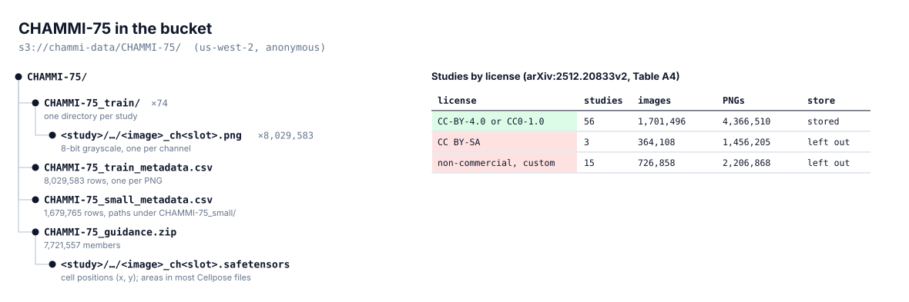
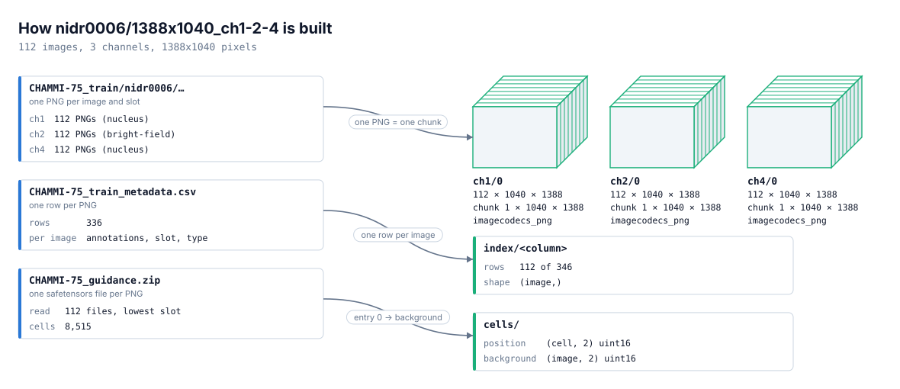
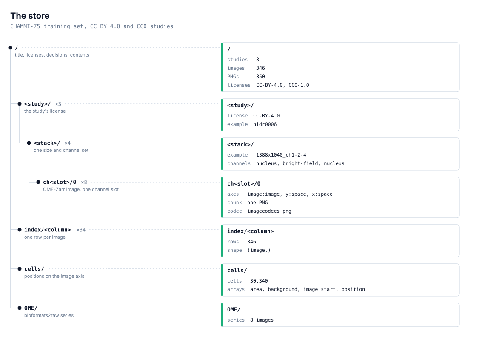

# CHAMMI-75: how the bucket maps onto the store

This page records where each part of the store comes from in
`s3://chammi-data/CHAMMI-75/`, which studies the store holds and under which
license, and what the source data taught along the way. The choices behind
the layout are in [PLAN.md](PLAN.md).

## Licenses

CHAMMI-75 pools studies under their own licenses, listed in Table A4 of the
paper (Agrawal et al., *CHAMMI-75: Pre-training multi-channel models with
heterogeneous microscopy images*,
[arXiv:2512.20833v2](https://arxiv.org/abs/2512.20833v2)). The store holds the
56 studies whose license is CC BY 4.0 or CC0 1.0. `ingest.py` keeps the table
below as two constants, `LICENSES` and `EXCLUDED`, and stops on any study in
the metadata that is in neither. The root's `licenses` attribute holds the
same table, and each study's group states its own license.

| License | Studies |
| --- | --- |
| CC BY 4.0 (47, stored) | idr0001 idr0002 idr0009 idr0010 idr0011 idr0022 idr0028 idr0030 idr0033 idr0035 idr0037 idr0056 idr0072 idr0081 idr0086 idr0089 idr0093 idr0115 idr0120 idr0123 idr0128 idr0129 idr0130 idr0133 idr0140 idr0145 nidr0001 nidr0002 nidr0004 nidr0005 nidr0006 nidr0008 nidr0009 nidr0010 nidr0012 nidr0013 nidr0014 nidr0015 nidr0016 nidr0017 nidr0019 nidr0020 nidr0025 nidr0027 nidr0028 nidr0029 nidr0030 |
| CC0 1.0 (9, stored) | idr0013 idr0080 idr0094 jump0001 nidr0003 nidr0007 nidr0011 nidr0023 nidr0024 |
| Share-alike (3, left out) | hpa0018 hpa0023 idr0025 |
| Non-commercial or custom terms (15, left out) | idr0003 idr0005 idr0006 idr0007 idr0008 idr0012 idr0017 idr0069 idr0088 nidr0018 nidr0021 nidr0022 nidr0031 nidr0032 wtc0001 |

The stored studies hold 1,701,496 of the release's 2,792,462 training images,
in 4,366,510 of its 8,029,583 PNGs, counted from the training metadata. The
test sets (Table A5) are not in the store.

## Mapping

| Source | Store |
| --- | --- |
| `CHAMMI-75_train/<study>/` | `<study>/`, with the study's license |
| The PNGs of a study's images that share a size, read from the PNG headers, and the same channel type in each slot | `<study>/<width>x<height>_ch<slots>/`, one stack |
| The PNG of image *r* in slot *s* of a stack | chunk *r* of `<stack>/ch<s>/0`, an OME-Zarr image `(image, y, x)`, referenced whole |
| `CHAMMI-75_train_metadata.csv`, one row per PNG | `index/<column>`, one row per image, sorted by stack then row |
| `CHAMMI-75_small_metadata.csv` | `index/in_small`, matched by image ID |
| `CHAMMI-75_guidance.zip`, the lowest slot's file of each image | `cells/position` and `cells/area`, on the index's image axis |
| Entry 0 of each Cellpose file in the zip | `cells/background` |

A stack's name is `<width>x<height>_ch<slots>`, with the slots joined by `-`.
Where two stacks of a study would share that name, because the same slots
hold different channel types, the types are appended:
`48x36_ch1-2_nucleus_protein`. Row *r* of every channel image in a stack is
the same image, and `index/stack` and `index/row` name it.

Each PNG is one chunk. Its shape, `(1, height, width)`, is the PNG's own
size, and the `imagecodecs_png` codec from `imagecodecs-zarr` decodes it. No
pixel is decoded or copied to build the store.

## What the source taught us

The release-wide counts below come from the October survey of every PNG
header and every file of the guidance zip. Each problem is kept as the source
states it where the store has a column for it, and corrected only in the
fields the store derives itself.

- **Every Cellpose position file starts with the background.** The
  maintainers' conversion loop runs over labels 0 to N−1 of a Cellpose mask, so
  entry 0 is label 0 and the last cell is lost
  ([`segment.py` L261–273 at b84a4ec](https://github.com/CaicedoLab/CHAMMI-75/blob/b84a4ec9ac19d933e1290afc5abfe6451423cac4/utils/segmentation/segment.py#L261-L273)).
  Their `config.tsv` routes every image group with positions to Cellpose
  except three idr0089 panels (threshold) and nidr0007 (snake). Some Cellpose
  files have no `sizes` tensor, which the published script never writes; their
  entry 0 still lies near the image center far more often than a later entry
  does. Entry 0 of every Cellpose-routed file moves to `cells/background`, and
  `index/segmentation` and `index/background_dropped` say which images. The
  missing last cell cannot be recovered.
- **The metadata states the wrong size for 397,130 PNGs** across the release.
  Stack shapes come from the PNG headers; `index/stated_width` and
  `index/stated_height` keep what the metadata states.
- **`geometry.channels` is wrong for 84,363 images** across the release.
  `index/n_channels` counts the files an image has; `index/stated_channels`
  keeps the stated value.
- **The small subset's paths point at `CHAMMI-75_small/`**, a prefix the
  bucket does not have. The subset is matched by image ID instead.
- **`microscopy.fov` is written two ways within one image**, `9` on one
  channel's row and `9.0` on another's. `index/fov` keeps one value per image,
  with numbers written one way.
- **The zip holds position files for idr0020**, a study that is not in the
  release, and three nidr0028 files that match no PNG. Neither is read.
- **Slot numbers do not name channels within a study.** In wtc0001 at 900×600,
  one panel string puts bright-field in slot 1 for 29,256 images and membrane
  for 4,476. wtc0001 is left out by its license, but the stack rule that
  separates such images applies to every study.
- **An image's channel files hold identical positions**, checked for all
  2,481,442 images with positions. Each image's positions are read from its
  lowest slot's file; `verify.py` compares them with the highest slot's file.
- **The source states no physical pixel size**, only magnification
  (`index/magnification`). The spatial scales are 1.0 with no unit, and the
  root's `not_recorded` attribute says so.
- **Each study's files lie together in the guidance zip.** All 70 studies with
  files in the zip occupy one contiguous run each, so a study's positions are
  read by streaming that run in a few large requests.
