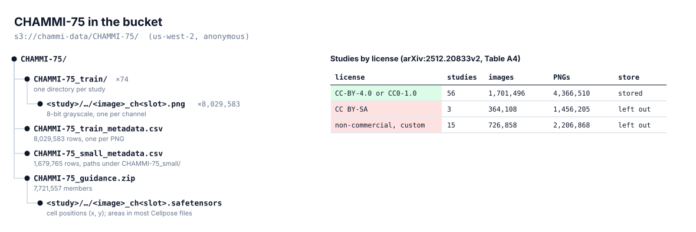
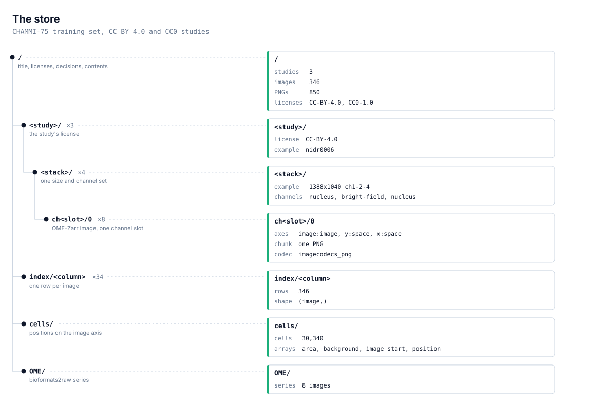

# CHAMMI-75, CC BY 4.0 and CC0 studies: ingest plan

## Summary

The plan builds a virtual Icechunk store of the 56 CHAMMI-75 training
studies whose license is CC BY 4.0 or CC0 1.0, in a new Arraylake repo,
`earthmover-biology/chammi-75`. The store references the dataset's own PNGs
in `s3://chammi-data/CHAMMI-75/` and copies none of them. It holds 1,701,496
of the release's 2,792,462 images, in 4,366,510 PNGs (3.24 TB).

The layout follows the October store, `earthmover-public/CHAMMI-75`, with one
change the repository's rules force: a stack of images can no longer be one
`(image, c, y, x)` array declared as an OME-Zarr image, because OME-Zarr allows
only one axis per image that is a channel or a custom type. Each channel slot
of a stack becomes its own OME-Zarr image, `(image, y, x)`, and every channel
image of a stack shares the image axis.

**The ask:** approve the layout and the judgement calls below, then the run
in `runs/01_allowlist.sh`. It runs on one Coiled VM in us-west-2 for about 40
minutes, at about $1, and writes to the branch `ingest` of the new repo.
Before it can run, you create the repo with its virtual chunk container (step
1 under "Steps").

| # | Decision | Recommendation | Status |
|---|---|---|---|
| 1 | Store only the CC BY 4.0 and CC0 studies of arXiv:2512.20833v2 Table A4 | An explicit allowlist in `ingest.py`; the run stops on any study in neither the allowlist nor the exclusion list | Required |
| 2 | One OME-Zarr image per channel slot of a stack | `<stack>/ch<slot>/0`, `(image, y, x)` | Proposed: the October layout breaks an OME-Zarr MUST |
| 3 | Keep `index/` as Zarr arrays, against the rule that sends tables to Iceberg | Keep it in the store, and publish the Iceberg table beside it in a later step | Proposed |
| 4 | Read every input from the bucket during the run | No dependence on October's local harvest files | Proposed |
| 5 | Write to a branch, verify, then move `main` | Branch `ingest`; you fast-forward `main` after reading the check | Proposed |
| 6 | Move each Cellpose file's entry 0 to `cells/background` | As in the October store | Signed off 2026-10-09 |
| 7 | One commit for the whole run; a failed study stops it | The index and the groups never disagree | Proposed |

## The archive

CHAMMI-75 pools multi-channel microscopy images from 74 public studies,
gathered by the Caicedo lab to pre-train models that accept any number of
channels (Agrawal et al.,
[arXiv:2512.20833v2](https://arxiv.org/abs/2512.20833v2);
[registry](https://registry.opendata.aws/chammi/)). The bucket is public and
read anonymously, in us-west-2.



- **`CHAMMI-75_train/`**: 8,029,583 PNGs, one 8-bit grayscale PNG per channel
  of each image, under one directory per study.
- **`CHAMMI-75_train_metadata.csv`**: 3.0 GB, one row per PNG, with the image
  it belongs to, its channel slot and type, and the image's annotations.
- **`CHAMMI-75_small_metadata.csv`**: the maintainers' small subset, whose
  paths start with a prefix the bucket does not have.
- **`CHAMMI-75_guidance.zip`**: 45 GB, 7,721,557 members, one safetensors file
  of cell positions per PNG. Its central directory alone is 1.49 GB.

The studies keep their own licenses. Table A4 of the paper lists them: 47
studies are CC BY 4.0 and 9 are CC0 1.0; 3 are share-alike and 15 carry
non-commercial or custom terms. LAYOUTS.md lists every study under its license.
The test sets (Table A5) are out of scope.

People use CHAMMI-75 to train models. The maintainers' loader picks images
from the metadata CSV and takes crops centered on the cell positions, so a
store serves that use if a loader can find images by annotation, read an
image's channels, and read its cells, without downloading the CSV or the zip.

## Proposed layout



```
/                          title, citation, licenses, decisions, contents
OME/                       bioformats2raw series: every channel image, in order
<study>/                   one per allowlisted study, with its license
  <w>x<h>_ch<slots>/       one stack: images of one size and channel set
    ch<slot>/              OME-Zarr image, one channel slot
      0                    (image, y, x) uint8; each chunk one PNG, referenced
index/<column>             (image,): one row per image, sorted by stack then row
cells/image_start          (image + 1,): index row i's cells are rows
                           image_start[i] to image_start[i + 1]
cells/position             (cell, 2) uint16: x, y in pixels
cells/area                 (cell,) uint32 pixels; 0 where the file has no sizes
cells/background           (image, 2) uint16: the moved entry 0, x, y
```

- **Referenced:** every pixel. A chunk is one whole PNG, `(1, height,
  width)`, decoded by `imagecodecs_png`. Nothing is decoded to build the store.
- **Written natively:** `index/` (34 columns) and `cells/` (4 arrays).
- **Iceberg:** nothing in this run; decision 3.
- **Axes and units:** `image` is a custom axis, `y` and `x` are space. The
  source states magnification only, so the spatial scale is 1.0 with no unit,
  recorded in the root's `not_recorded` attribute. There are no lower
  resolution levels: a PNG is the smallest unit the source stores.
- **Counts:** 1,038 stacks and 1,353 channel images over the 56 studies, from
  the October PNG headers. The store has 1,391 arrays, against 1,431 in the
  October store of all 74 studies.

A stack holds a study's images that share a size, read from the PNG headers,
and the same channel type in each slot. LAYOUTS.md says how each part of the
bucket maps onto this tree and records the source's errors.

### Layouts considered and rejected

- **`(image, c, y, x)` per stack, declared an OME-Zarr image** (the October
  layout). OME-Zarr 0.5 and 0.6 allow one axis that is a channel or of a
  custom type; `image` and `c` make two. The schema validates it anyway, and
  `minus80.ome.image_attrs` refuses it ([ingest.md, "Read the spec's
  structures before designing a
  hierarchy"](../../docs/ingest.md#read-the-specs-structures-before-designing-a-hierarchy)).
- **`(image, c, y, x)` as plain Zarr, with no `ome` block.** Valid, and a
  training loader reads all of an image's channels in one call. No OME-Zarr
  tool would open any pixel, so the store would fail its central test.
- **One OME-Zarr image per CHAMMI image**, `(c, y, x)`. This is the shape the
  spec has in mind, but it makes 1.7 million images and as many arrays. A
  commit writes a manifest per array, and a reader fetches the whole snapshot
  on open, whose node cache holds 500,000 nodes by default.
- **Both the channel images and a plain `(image, c, y, x)` array over the
  same PNGs.** It doubles the manifests (4.4 million more references) to save
  a loader one call per channel. Each call reads the same PNG either way.

## What has been tested

All on a laptop, against the real bucket, into a local Icechunk repo, on
2026-11-19.

- **The trial:** nidr0006, nidr0013 and nidr0014, 346 images, 850 PNGs, 4
  stacks, 8 channel images, 30,340 cells. With the inputs already kept, the run
  took 4 s, 3 studies at once in spawned processes, each in its own fork,
  merged and committed once.
- **The inputs, once:** fetching the zip's 1.49 GB central directory and
  parsing it took 157 s from the laptop, at 7.0 GB peak memory. The metadata's
  Parquet copies were reused from October, made by the same DuckDB conversion
  `pipeline.metadata_parquet` runs; the fixture test runs that conversion.
- **`verify.py` on the trial store:** every check passes in 4 s: licenses,
  completeness against the metadata, the eight OME-Zarr gates, one chunk per
  study against PIL's decode of the PNG, and one image's cells per study
  against its highest slot's file in the zip.
- **Against the October store:** for the 346 trial images, every index column
  and every image's cells and background equal the October store's, which was
  built by separate code and verified against the source in full.
- **The cold-open notebook** runs against the trial store, and the plotted
  cells sit on the nuclei.
- **The fixture tests:** `test_ingest.py` builds a scaled-down archive with
  the bucket's layout: PNGs, both CSVs and a STORED zip of safetensors files,
  covering the collision of stack names, a missing position file, Cellpose
  files with and without `sizes`, a snake-segmented study and an excluded
  study present in every source file. 12 tests pass, including `verify.py` and
  a check of every plane and every cell.
- **Sizes of the full run:** each of the 70 studies with files in the zip
  occupies one contiguous run of it, 23.8 GB for the 56 allowlisted studies.
  Streaming a study's run reads it in 16 MiB requests.

Not tested: a commit to Arraylake, forks pickled to spawned processes against
an Arraylake repo, and the full run's time and memory. The October harvest
read every PNG header in-region at 6,880 a second and the whole zip at
263 MB/s, so the 4.37 million headers should take about 11 minutes and the
23.8 GB of positions under 2 minutes.

## Judgement calls

1. **The license allowlist.** The 56 studies of Table A4 under CC BY 4.0 or
   CC0 1.0 are a constant, `LICENSES`, and the 18 others are `EXCLUDED`, with
   the reason. The run raises if the metadata names a study in neither, so a
   study added to a later release waits for someone to read its license.
   Asking for an excluded study raises too. The index and cells are gathered
   only from stored studies, and both `ingest.py` and `verify.py` check that no
   row of another study is present. The root keeps the whole table, so a
   reader can see which studies were left out and why. Recommendation: as
   built.
2. **One OME-Zarr image per channel slot.** Argued under "Layouts considered
   and rejected". The cost falls on training loaders: reading one image means
   one array read per slot, and `index/channels` lists the slots. The number
   of PNG requests is the same. Recommendation: channel images.
3. **`index/` stays in Zarr.** AGENTS.md sends tabular data without a Zarr
   convention to an Iceberg table. The index is one, but `cells/` is aligned
   on its image axis, and without it a reader of the store cannot tell which
   image a row of a stack is. The October store kept both, with the table
   `chammi-75-tables.images` published from the store's index. Recommendation:
   keep `index/` in the store, and add the Iceberg table as a later step,
   after a separate approval for the write.
4. **Inputs read from the bucket in-region.** The October build read three
   local files from earlier runs: the PNG headers, the zip's member index and
   the harvested cells. This run reads everything from the public bucket
   itself: the metadata CSVs, the zip's central directory, each study's PNG
   headers and its run of the zip. It costs about 15 minutes of reading on
   the VM, and the run depends on nothing but the bucket and the committed
   code. Recommendation: as built.
5. **Branch first.** The run writes to `ingest`, created from `main`'s tip,
   and `verify.py` runs against that branch at the end of the job. You move
   `main` once the check has passed. Recommendation: as built.
6. **The background entry.** Entry 0 of every file the maintainers'
   `config.tsv` routes to Cellpose moves to `cells/background`, with or
   without a `sizes` tensor; threshold and snake files are kept whole. Signed
   off for the October store on 2026-10-09; LAYOUTS.md gives the evidence.
7. **One commit, or none.** Each study runs in a fork. If any study fails,
   the run stops before merging and commits nothing beyond the root group,
   and the run is repeated. Committing the studies that succeeded would leave
   an index that a later run must rebuild from every study again, because the
   per-study tables live on the VM's disk. Recommendation: as built; at about
   40 minutes a run, repeating one is cheap.
8. **Display colors.** The source states none. Nuclei are blue, transmitted
   light and EM gray, and other channels take colors in a fixed order within
   a stack. Recommendation: as built.
9. **Repo settings you choose when creating it.** The October repo splits
   each stack's manifest into 1,000-image shards. A training loader that opens
   one stack then fetches only the shards it reads. Recommendation: the same
   splitting, which is a repo setting rather than code.

## Steps, scope and risk

### Steps

1. **You:** create `earthmover-biology/chammi-75` on Arraylake with a virtual
   chunk container for `s3://chammi-data/` (anonymous, us-west-2), and grant
   the ingest token write on it. Writing to the org needs your approval.
2. **You:** approve this plan.
3. **Run 1:** `ARRAYLAKE_TOKEN=... bash runs/01_allowlist.sh`. One
   `coiled batch run` on an m6i.4xlarge in us-west-2: install, read the
   inputs, write the 56 studies eight at a time, merge, write `index/` and
   `cells/`, commit once to `ingest`, then run `verify.py` against `ingest`.
   The launcher refuses uncommitted code, and the job prints the commit it ran
   from.
4. **You:** read the job's check, then fast-forward `main` to `ingest`.
5. **Me:** write `REPORT.md` from the run and update `runs/01_allowlist.sh`
   with what happened.
6. **Later, separately approved:** the Iceberg table of the index.

### Scope

- **In:** the training set's 56 allowlisted studies, their pixels, index and
  cells.
- **Out:** the 18 other studies, the test sets, the Iceberg table, and any
  change to the October store.

### Cost

One m6i.4xlarge for about 40 minutes, about $1 of compute plus Coiled's fee.
Reads of the bucket stay in us-west-2. The store adds about 1.2 GB of native
`cells/` chunks and a few hundred MB of manifests to Arraylake.

### Risk

- **The commit to Arraylake is untimed.** The October pixels commit took
  about 7 minutes from a laptop. `MANIFEST_FETCH_CONCURRENCY` is now 256,
  which made commits about six times faster in another ingest. The job's hard
  limit is 75 minutes for the ingest.
- **Memory.** Parsing the central directory peaked at 7.0 GB on the laptop.
  Eight studies streaming at once hold at most 512 MiB of the zip each, and
  the driver holds about 333 million cells, about 2.7 GB, while writing
  `cells/`. The VM has 64 GB, and the job logs memory every 15 s.
- **A reader with expired AWS credentials in the environment** cannot read
  the pixels of a local copy of the repo, because `open_repository` takes S3
  credentials from the environment unless `MINUS80_S3_ANONYMOUS=1` is set.
  Arraylake applies the container's anonymous access itself, so readers of
  the published repo are not affected.
